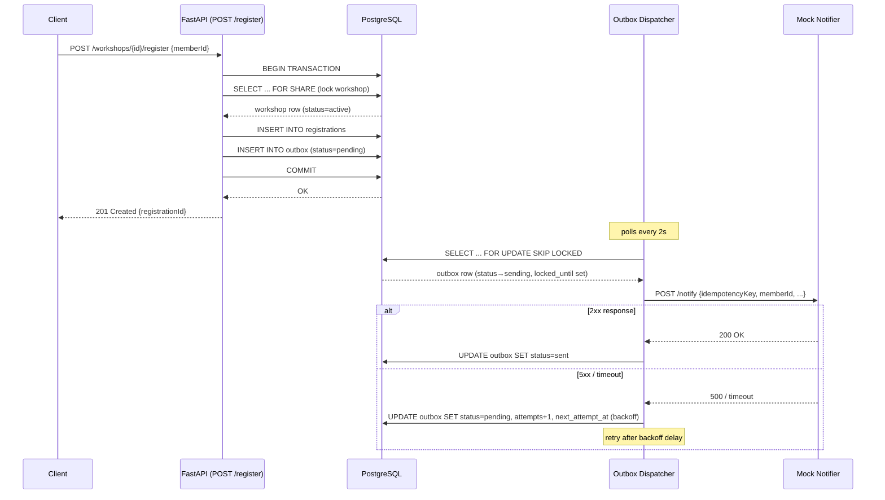

# Workshop Registration & Notifications — Design Document

## Overview

This service implements the **Transactional Outbox** pattern to guarantee
at-least-once delivery of workshop confirmation and cancellation notifications
without coupling registration throughput to notifier availability.

---

## 1. Lost Notifications — How the Outbox Prevents Them

### The Problem
If we called the notification service directly inside the HTTP handler, a network
glitch, service restart, or notifier downtime would silently drop a notification.

### The Solution: Transactional Outbox
Every notification is first written as a row in the `outbox` table **in the same
database transaction** as the business operation (registration or cancellation).

```
POST /register
    ├── BEGIN TRANSACTION
    ├── INSERT INTO registrations …
    ├── INSERT INTO outbox (status='pending') …
    └── COMMIT
```

Because both writes are in one transaction:
- If the registration fails → outbox row is rolled back too. No orphan notification.
- If the outbox insert fails → registration is rolled back too. No missing notification.
- If the backend crashes after COMMIT → the outbox row is already persisted. The
  dispatcher will pick it up on restart.

The dispatcher is a background `asyncio` task that polls the outbox and delivers
rows to the notifier. It is completely decoupled from the HTTP handler.

---

## 2. Retries — Backoff, Jitter, Max Attempts, Dead Letters

### Dispatcher Polling
The dispatcher runs a loop every `DISPATCHER_POLL_INTERVAL` seconds. Each cycle:

1. **Claim** a batch of due rows with `SELECT … FOR UPDATE SKIP LOCKED`, setting
   `status='sending'` and `locked_until=now()+lease`.
2. **Deliver** each row concurrently (bounded by `DISPATCHER_CONCURRENCY`).
3. **Mark sent** (`status='sent'`) on a `2xx` response.
4. **Release and schedule retry** on any error.

### Exponential Backoff with Jitter
```python
delay = min(base * 2^attempts, cap)
jitter = random.uniform(-delay*factor, +delay*factor)
next_attempt_at = now() + delay + jitter
```

| Attempt | Base delay | With jitter (±25%) |
|---------|-----------|---------------------|
| 0 → 1   | 2s        | 1.5s – 2.5s         |
| 1 → 2   | 4s        | 3s – 5s             |
| 2 → 3   | 8s        | 6s – 10s            |
| 3 → 4   | 16s       | 12s – 20s           |
| 4 → 5   | 32s       | 24s – 40s           |

Jitter prevents **thundering-herd**: if 100 rows all fail simultaneously, they
are not all rescheduled for the exact same time.

### Dead Letters
After `max_attempts` (default 5) consecutive failures, the row is marked
`status='dead'` and logged at ERROR level. Dead rows are:
- Visible via `GET /admin/outbox/dead`
- Manually retryable via `POST /admin/outbox/{id}/retry`

This forces an operator to acknowledge permanent failures rather than silently
dropping them.

---

## 3. Duplicate Delivery — Why Exactly-Once Is Not Claimed

### At-Least-Once
A delivery timeout is ambiguous: the notifier may have received the request and
sent the notification before the connection dropped. If we then retry, we may
deliver twice.

We **cannot** guarantee exactly-once delivery without a distributed transaction
spanning the database and the notifier — which would be fragile and slow.

### Idempotency Key Approach
Instead:
1. Every attempt sends the outbox row's `id` as an `Idempotency-Key` HTTP header.
2. The mock notifier stores received keys and ignores duplicates:
   - First delivery of a key → `outcome=delivered`.
   - Subsequent deliveries → `outcome=duplicate`, incremented counter.
3. The outbox row is marked `sent` only on a `2xx` response, so the dispatcher
   will retry until it gets one.

**Result**: At-least-once delivery with idempotency protection at the receiver.
The demo's final audit (`/stats` vs DB) proves no notification is lost and
duplicates are counted but not double-processed.

---

## 4. Backend Restarts — Lease-Based Recovery

### The Problem
If the dispatcher claims a row (sets `status='sending'`) and then the backend
crashes, the row is stuck in `sending` forever — no new worker will claim it.

### Lease Solution
Every claim sets `locked_until = now() + DISPATCHER_LEASE_SECONDS` (default 30s).

The claim query includes:
```sql
WHERE status IN ('pending', 'sending')
  AND next_attempt_at <= now()
  AND (locked_until IS NULL OR locked_until < now())
```

So a `sending` row with an expired lease is treated as `pending` again and
re-claimed. On restart, the new dispatcher simply runs its normal poll — it does
not need to know a crash occurred.

### `SKIP LOCKED`
Multiple dispatcher instances can run concurrently. `FOR UPDATE SKIP LOCKED`
ensures they never claim the same row; each instance works on a distinct subset.

---

## 5. Register vs Cancel Race Condition

### Locking Strategy

| Operation    | Lock mode  | Effect                                          |
|--------------|------------|-------------------------------------------------|
| Registration | `FOR SHARE` | Blocks concurrent `FOR UPDATE` (cancellation)  |
| Cancellation | `FOR UPDATE` | Blocks concurrent `FOR SHARE` (registration)  |

This creates a **serialisation point** at the workshop row:

- If **registration wins the lock first**: cancellation waits. When cancellation
  runs, it sees the new member in `registrations` and includes them in the bulk
  `INSERT … SELECT` for outbox rows.
- If **cancellation wins the lock first**: registration waits. When registration
  runs, it reads `status='cancelled'` and raises `WorkshopCancelledError`.

No member can be missed, and no registration can sneak through after cancellation.

---

## 6. Sequence Diagram — Registration & Delivery



---

## 7. Limitations & What We Would Use at Larger Scale

### Current Limitations

| Limitation | Impact |
|------------|--------|
| **Polling latency** | Minimum latency = `DISPATCHER_POLL_INTERVAL` (2s). A row can wait up to 2s before first delivery attempt. |
| **Single outbox table as hot row** | At very high registration rates (thousands/sec), the polling query scans the same partial index. May become a bottleneck. |
| **In-process dispatcher** | The dispatcher runs inside the same FastAPI process. A long-running delivery blocks the event loop less (async), but a serious dispatcher bug could destabilise the HTTP server. |
| **No ordering guarantee** | Rows are claimed by `next_attempt_at` which mixes new and retried rows. A member may receive a retry notification before a fresh one. |
| **In-memory notifier state** | The mock notifier loses all stats on restart. Fine for demo; unacceptable in production. |

### Larger-Scale Alternatives

- **`LISTEN/NOTIFY`**: PostgreSQL can send a `NOTIFY` when an outbox row is
  inserted. The dispatcher subscribes with `LISTEN` and wakes up immediately
  instead of polling. Reduces latency from O(poll interval) to O(network RTT).
- **Dedicated message broker** (Kafka, RabbitMQ, AWS SQS): the outbox relay
  writes rows to a topic instead of polling. Consumers scale independently.
  Better throughput, built-in ordering per partition, native dead-letter queues.
- **Separate dispatcher process**: run the dispatcher as its own container/pod
  so it can be scaled and deployed independently of the HTTP API.
- **Alembic migrations**: replace idempotent `IF NOT EXISTS` DDL with proper
  versioned migrations for production schema management.
- **Prometheus metrics**: expose `outbox_rows_pending`, `outbox_rows_dead`,
  `delivery_latency_seconds` for observability.
